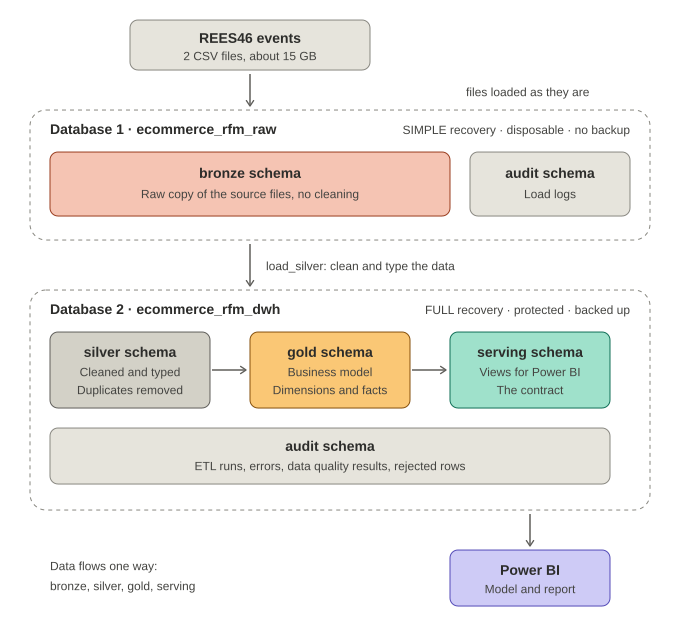
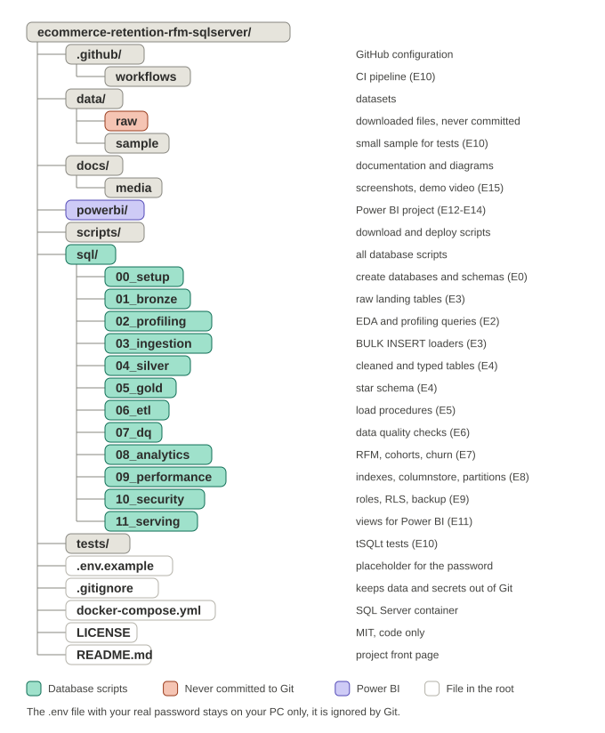

# E-commerce Customer Retention & RFM: SQL Server Data Platform

A production-style data platform in SQL Server, built on a large e-commerce event stream, that answers four business questions: **who are our best customers, who is at risk of leaving, how well do we retain customers, and where do shoppers drop out?**

> **Status:** work in progress. Results, benchmarks and the Power BI report will be added as each phase is completed.

## Architecture

Two databases separate the raw data from the clean data. A database is the unit of backup and recovery, and only the clean data needs protection.



| Database | Schemas | Purpose |
|---|---|---|
| `ecommerce_rfm_raw` | `bronze`, `audit` | Raw copy of the source files. `SIMPLE` recovery, disposable, rebuilt from the files |
| `ecommerce_rfm_dwh` | `silver`, `gold`, `audit`, `serving` | Cleaned and modeled data, protected and backed up. `serving` holds the views used by Power BI |

Data flows one way: **bronze, silver, gold, serving**. Naming rules are in [`docs/conventions.md`](docs/conventions.md).

## Data

One public dataset: **REES46 eCommerce behavior data** (Kaggle), a real multi-category online store. Two monthly files (October and November 2019, about 15 GB) of events: product views, cart additions and purchases.

Raw data is **not** included in this repository. Source, license and data policy are in [`docs/data_sources.md`](docs/data_sources.md).

**Limits, stated up front:** the data covers about two months, so retention and churn are measured in weeks. There is no order ID (an order is approximated by a session with a purchase), no quantity and no cancellations.

## Scope

**Part 1: SQL Server**
- Bulk loading of about 15 GB of CSV files into a layered architecture
- A normalized silver layer with primary and foreign keys, and a star schema with SCD Type 2
- Join and constraint experiments at scale (trusted foreign keys, join strategies, execution plans)
- Incremental ETL with audit and error logging
- Automated data quality checks with quarantine
- RFM, weekly cohort retention, churn, funnel and cart abandonment analysis
- Performance tuning with measured before/after results (indexes, columnstore, partitioning, Query Store)
- Security (roles, row-level security, masking), backup and a tested restore
- tSQLt tests and a GitHub Actions pipeline

**Part 2: Power BI**
- Semantic model and a documented DAX measure library
- Model performance and row-level security
- A report with insights and recommendations

## Documentation

| Document | Content |
|---|---|
| [`docs/business_requirements.md`](docs/business_requirements.md) | Business context, stakeholders, scope, questions |
| [`docs/metric_dictionary.md`](docs/metric_dictionary.md) | One definition per KPI |
| [`docs/rfm_rules.md`](docs/rfm_rules.md) | RFM scoring and segments |
| [`docs/churn_definition.md`](docs/churn_definition.md) | Churn rule and validation |
| [`docs/conventions.md`](docs/conventions.md) | Naming and T-SQL style |

## Repository structure



## Run it locally

SQL Server runs in Docker. You need Docker Desktop and a `.env` file with your own password.

```powershell
copy .env.example .env      # then edit the password in .env
docker compose up -d
```

Connect with SSMS to `localhost,1434` (login `sa`). More setup steps will be added as the project grows.

## License

The code is released under the MIT license (see `LICENSE`). The dataset keeps its own license, listed in `docs/data_sources.md`.
