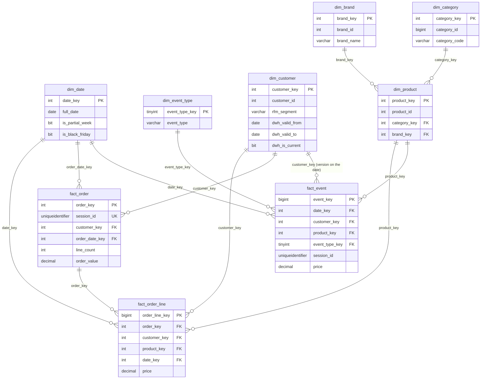

# Entity Relationship Diagram (E4-07)

Project: E-commerce Customer Retention & RFM (SQL Server)

Gold layer (star schema). Facts are in the middle, dimensions around them.
GitHub draws this diagram from the text below.

